# Banco de dados — OrtoEmpresta

| Arquivo | Conteúdo |
|---|---|
| [`MER.json`](MER.json) | MER lógico (export do Lucidchart) ajustado à Spec 001: nomes em português, ids `bigint` |
| [`backend/src/main/resources/db/migration/V1__init_schema.sql`](../../backend/src/main/resources/db/migration/V1__init_schema.sql) | Script físico **PostgreSQL** (Flyway), nomes em inglês |
| [`V2__frente_g_sessoes_sincronizacao.sql`](../../backend/src/main/resources/db/migration/V2__frente_g_sessoes_sincronizacao.sql) | Sessões (RN57) e sincronização offline (RN60) |

O diagrama abaixo é gerado a partir do `MER.json`. O original continua no Lucidchart
(link no `README.md` e na aba "Banco de Dados" da planilha). Para atualizar lá, refaça as mudanças listadas em
[Ajustes feitos no MER](#ajustes-feitos-no-mer).

## Como criar o banco

O perfil `prod` aplica a migration ao subir e o Hibernate só **valida** o mapeamento (`ddl-auto: validate`):

```bash
createdb lionsdb   # PostgreSQL 14+
SPRING_PROFILES_ACTIVE=prod \
SPRING_DATASOURCE_URL=jdbc:postgresql://localhost:5432/lionsdb \
SPRING_DATASOURCE_USERNAME=postgres SPRING_DATASOURCE_PASSWORD=postgres \
LIONS_JWT_SECRET=<base64 de 256 bits> LIONS_ADMIN_PASSWORD=<senha forte> \
./gradlew bootRun
```

Também dá para rodar o script direto (`psql -d lionsdb -f V1__init_schema.sql`), mas aí suba a aplicação com
`SPRING_FLYWAY_ENABLED=false` ou faça `flyway baseline`. Alterações futuras entram como `V2__...sql`, `V3__...sql`
— **nunca** edite a V1 depois de aplicada em produção.

O perfil `dev` (padrão) e os testes continuam em H2 com o schema gerado pelo Hibernate. A suíte de testes também passa
contra PostgreSQL com a V1 (`SPRING_DATASOURCE_URL=... SPRING_FLYWAY_ENABLED=true SPRING_JPA_HIBERNATE_DDL_AUTO=validate
./gradlew test --no-daemon`).

## MER lógico → tabelas físicas

| MER (`MER.json`) | Tabela física | Observações |
|---|---|---|
| `tb_usuario` | `tb_users` | `login` → `username`; `cargo` → `role`; `status` → `active` |
| `tb_beneficiario` | `tb_beneficiaries` | `CPF` → `cpf` (só dígitos, único entre ativos); `dependente` → `legally_incapable`; `*_resp` → `legal_guardian_*`; `*_contato_alt` → `alternative_contact_*` |
| `tb_endereco` | `tb_addresses` | 1:1 via `tb_beneficiaries.address_id`; `numero` é texto ("S/N") |
| `tb_beneficiario_canal` | `tb_beneficiary_channels` | canais autorizados no consentimento (RN07/RN47) |
| `tb_equipamento_tipo` | `tb_equipment_types` | PK = código do enum (`CADEIRA_DE_RODAS`…); `prazo_dias` → `loan_days` (RN18) |
| `tb_equipamento` | `tb_equipments` | `ano` → `manufacture_year`; `porte` → `equipment_size`; `conservacao` → `equipment_condition` |
| `tb_especificacao` | `tb_equipment_specifications` | PK composta (`equipment_id`, `position`) |
| `tb_solicitacao` | `tb_loan_orders` | pedido público/assistido |
| `tb_emprestimo` | `tb_loans` | termo, assinatura e cancelamento no próprio empréstimo |
| `tb_emprestimo_renovacao` | `tb_loan_renewals` | |
| `tb_emprestimo_devolucao` | `tb_loan_returns` | 1:1 com o empréstimo |
| `tb_ocorrencia` | `tb_occurrences` | DANO / INADIMPLENCIA |
| `tb_fila_espera` | `tb_waitlist_entries` | `recusas` → `consecutive_expirations`; `id_equipamento` → `reserved_equipment_id` |
| `tb_manutencao` | `tb_maintenances` | |
| `tb_manutencao_custo` | `tb_maintenance_costs` | |
| `tb_notificacao` | `tb_notifications` | |
| `tb_auditoria` | `tb_audit_logs` | somente inserção |
| `tb_parametro` | `tb_system_parameters` | |
| `tb_conteudo_ajuda` / `tb_conteudo_ajuda_publico` | `tb_help_contents` / `tb_help_content_audiences` | |
| `tb_sessao_usuario` | `tb_user_sessions` | V2 — uma sessão por token (`jti`), encerramento auditado (RN57) |
| `tb_sincronizacao_operacao` | `tb_sync_operations` | V2 — operações offline recebidas; `client_operation_id` único (idempotência) |
| `tb_sincronizacao_conflito` | `tb_sync_conflicts` | V2 — conflitos para conferência manual (RN60) |
| — | `tb_lions_clubs`, `tb_members`, `tb_social_actions` | dados do clube, fora da planilha |

Convenções físicas que o MER não mostra:

- `created_at` e `updated_at` em quase todas as tabelas.
- Os autores de operações ("…_por", `id_usuario` do MER) são gravados como **username** (texto), não como FK.
  Assim a trilha continua legível mesmo se o usuário for renomeado ou inativado.
- Enums gravados pelo nome, com `CHECK` dos valores aceitos.
- Índices únicos parciais garantem no banco:
  - **RN04:** CPF único entre os beneficiários ativos;
  - **RN28:** um empréstimo em aberto por equipamento;
  - **RN31:** uma posição ativa na fila por beneficiário e tipo;
  - uma manutenção em andamento por equipamento.

## Ajustes feitos no MER

Em relação ao export original do Lucidchart:

1. **Correções**
   - Ids de `UUID` para `bigint`.
   - `tb_espeficacao` renomeada para `tb_especificacao`.
   - A linha que saía de `tb_emprestimo` sem destino agora liga `tb_emprestimo` N:1 `tb_beneficiario`.
2. **`tb_endereco`:** `numero` passou a ser `varchar` e ganhou `UF`.
3. **`tb_beneficiario`:**
   - ganhou contato alternativo (RN05);
   - ganhou quem deu o consentimento e o flag de aceite (RN07);
   - ganhou motivo e data de inativação;
   - ganhou anonimização (RN59);
   - CPF e CPF do responsável passaram a `varchar(11)`.
4. **`tb_equipamento`:**
   - ganhou foto;
   - ganhou motivo, observação, data e autor da baixa (RN13);
   - ganhou o beneficiário da reserva (RN32);
   - ganhou última manutenção e ciclos (RN39);
   - ganhou versão para concorrência (RN28).
5. **`tb_equipamento_tipo`:** a PK passou a ser o código do tipo, e a tabela ganhou descrição e `prazo_dias` (RN18).
6. **`tb_emprestimo`:**
   - `id_fila_espera` foi trocado por `id_solicitacao`;
   - ganhou prazo inicial, retroativo e justificativa (RN22), estado e foto na entrega;
   - ganhou hash e data do termo, e tipo, data e autor da assinatura (RN21, RN61);
   - ganhou autor e data do cancelamento (RN26).
   - A vistoria da devolução foi para **`tb_emprestimo_devolucao`** (RN24, RN40).
7. **`tb_emprestimo_renovacao`:** ganhou autor e data (RN25).
8. **`tb_manutencao`:**
   - ganhou tipo (corretiva/preventiva), responsável técnico (RN36), empréstimo de origem (RN24) e quem encerrou;
   - o campo único `custo` virou a tabela **`tb_manutencao_custo`**, com peça trocada e ajustes (RN38, RN41).
9. **`tb_fila_espera`:**
   - ganhou motivo e autorização da prioridade (RN30);
   - ganhou a data original da solicitação;
   - ganhou motivo e data de saída;
   - ganhou o vínculo com a solicitação.
10. **Tabelas novas exigidas pelas RNs e pelos RFs:**
    - `tb_solicitacao` (RF09)
    - `tb_ocorrencia` (RN27, RN40)
    - `tb_notificacao` (RN46–RN49)
    - `tb_beneficiario_canal` (RN47)
    - `tb_auditoria` (RN44, RN52, RN58)
    - `tb_parametro` (RN18, RN19, RN39, RN45)
    - `tb_conteudo_ajuda` e `tb_conteudo_ajuda_publico` (RN53)

11. **Tabelas da V2 (Frente G):** `tb_sessao_usuario` (RN57), `tb_sincronizacao_operacao` e
    `tb_sincronizacao_conflito` (RN60).

## Diagrama

```mermaid
erDiagram
    tb_usuario ||--o{ tb_fila_espera : ""
    tb_equipamento ||--o{ tb_especificacao : ""
    tb_equipamento_tipo ||--o{ tb_equipamento : ""
    tb_beneficiario ||--o{ tb_fila_espera : ""
    tb_endereco ||--|| tb_beneficiario : ""
    tb_beneficiario ||--o{ tb_emprestimo : ""
    tb_usuario ||--o{ tb_emprestimo : ""
    tb_emprestimo ||--o{ tb_emprestimo_renovacao : ""
    tb_equipamento ||--o{ tb_manutencao : ""
    tb_equipamento ||--o{ tb_fila_espera : ""
    tb_usuario ||--o{ tb_manutencao : ""
    tb_equipamento_tipo ||--o{ tb_fila_espera : ""
    tb_equipamento ||--o{ tb_emprestimo : ""
    tb_beneficiario ||--o{ tb_beneficiario_canal : ""
    tb_beneficiario ||--o{ tb_solicitacao : ""
    tb_equipamento_tipo ||--o{ tb_solicitacao : ""
    tb_solicitacao ||--o{ tb_emprestimo : ""
    tb_solicitacao ||--o{ tb_fila_espera : ""
    tb_emprestimo ||--|| tb_emprestimo_devolucao : ""
    tb_beneficiario ||--o{ tb_ocorrencia : ""
    tb_emprestimo ||--o{ tb_ocorrencia : ""
    tb_manutencao ||--o{ tb_manutencao_custo : ""
    tb_emprestimo ||--o{ tb_manutencao : ""
    tb_beneficiario ||--o{ tb_notificacao : ""
    tb_emprestimo ||--o{ tb_notificacao : ""
    tb_beneficiario ||--o{ tb_equipamento : ""
    tb_conteudo_ajuda ||--o{ tb_conteudo_ajuda_publico : ""
    tb_equipamento ||--o{ tb_sincronizacao_conflito : ""
    tb_emprestimo ||--o{ tb_sincronizacao_conflito : ""
    tb_emprestimo ||--o{ tb_sincronizacao_operacao : ""
    tb_sincronizacao_conflito ||--o{ tb_sincronizacao_operacao : ""
    tb_usuario {
        bigint id PK
        varchar nome
        varchar login
        varchar email
        varchar senha
        boolean status
        varchar cargo
        timestamp dt_ultimo_login
        timestamp dt_cadastro
    }
    tb_emprestimo {
        bigint id PK
        bigint id_beneficiario FK
        bigint id_equipamento FK
        bigint id_solicitacao FK
        bigint id_usuario FK
        varchar status
        date dt_retirada
        date dt_prevista_inicial
        date dt_prevista
        int renovacoes
        date dt_ultima_renovacao
        boolean retroativo
        varchar justificativa_retroativo
        varchar estado_entrega
        varchar observacoes
        varchar foto_entrega_url
        varchar termo_pdf
        varchar64 termo_hash
        timestamp dt_termo
        varchar tipo_assinatura
        timestamp dt_assinatura
        varchar assinado_por
        varchar assinatura_doc
        varchar assinatura_registrada_por
        timestamp dt_devolucao
        varchar motivo_cancelamento
        varchar cancelado_por
        timestamp dt_cancelamento
    }
    tb_emprestimo_renovacao {
        bigint id PK
        bigint id_emprestimo FK
        date dt_entrega_anterior
        date dt_entrega_nova
        varchar renovado_por
        timestamp dt_renovacao
    }
    tb_manutencao {
        bigint id PK
        bigint id_equipamento FK
        bigint id_usuario FK
        varchar tipo
        varchar status
        date dt_entrada
        date dt_saida
        varchar descricao
        varchar responsavel_tecnico
        varchar parecer
        bigint id_emprestimo_origem FK
        varchar encerrado_por
    }
    tb_beneficiario {
        bigint id PK
        bigint id_endereco FK
        varchar11 CPF
        varchar nome
        date dt_nascimento
        varchar telefone
        varchar email
        varchar nome_contato_alt
        varchar telefone_contato_alt
        varchar relacao_contato_alt
        boolean dependente
        varchar nome_resp
        varchar11 CPF_resp
        varchar telefone_resp
        varchar email_resp
        varchar relacao_resp
        boolean aceite_lgpd
        timestamp dt_aceite_lgpd
        varchar aceite_por
        boolean status
        timestamp dt_inativacao
        varchar motivo_inativacao
        boolean anonimizado
        timestamp dt_anonimizacao
        text observacoes
        timestamp dt_cadastro
    }
    tb_endereco {
        bigint id PK
        varchar CEP
        varchar rua
        varchar numero
        varchar complemento
        varchar bairro
        varchar cidade
        char2 UF
    }
    tb_fila_espera {
        bigint id PK
        bigint id_beneficiario FK
        varchar tipo FK
        bigint id_solicitacao FK
        varchar status
        timestamp dt_solicitacao
        timestamp dt_solicitacao_original
        boolean prioridade
        varchar motivo_prioridade
        varchar justificativa
        varchar autorizado_por
        bigint id_equipamento FK
        timestamp dt_reserva
        timestamp dt_expiracao
        int recusas
        varchar motivo_remocao
        timestamp dt_encerramento
        bigint id_usuario FK
    }
    tb_equipamento {
        bigint id PK
        varchar patrimonio
        varchar tipo FK
        varchar porte
        int ano
        varchar conservacao
        varchar status
        varchar observacoes
        varchar foto_url
        bigint id_beneficiario_reserva FK
        varchar motivo_baixa
        varchar obs_baixa
        date dt_baixa
        varchar baixado_por
        date dt_ultima_manutencao
        int ciclos_desde_manutencao
        bigint versao
        timestamp dt_cadastro
    }
    tb_equipamento_tipo {
        varchar tipo PK
        varchar descricao
        int prazo_dias
        varchar atualizado_por
        timestamp dt_atualizacao
    }
    tb_especificacao {
        bigint id_equipamento FK
        int posicao
        varchar nome
        varchar valor
    }
    tb_beneficiario_canal {
        bigint id_beneficiario FK
        varchar canal
    }
    tb_solicitacao {
        bigint id PK
        bigint id_beneficiario FK
        varchar tipo FK
        boolean para_si
        varchar nome_solicitante
        varchar parentesco_solicitante
        text motivo_necessidade
        varchar status
        varchar motivo_rejeicao
        boolean cadastro_assistido
        varchar decidido_por
        timestamp dt_decisao
        timestamp dt_cadastro
    }
    tb_emprestimo_devolucao {
        bigint id PK
        bigint id_emprestimo FK
        date dt_devolucao
        varchar estado_devolucao
        varchar descricao_avaria
        varchar foto_url
        boolean com_avaria
        varchar recebido_por
    }
    tb_ocorrencia {
        bigint id PK
        bigint id_beneficiario FK
        bigint id_emprestimo FK
        varchar tipo
        varchar status
        varchar descricao
        boolean automatica
        varchar criado_por
        timestamp dt_resolucao
        varchar resolvido_por
        varchar nota_resolucao
        timestamp dt_cadastro
    }
    tb_manutencao_custo {
        bigint id PK
        bigint id_manutencao FK
        varchar tipo
        varchar descricao
        varchar peca_trocada
        numeric12_2 valor
        boolean ajuste
        varchar motivo_ajuste
        varchar registrado_por
        timestamp dt_registro
    }
    tb_notificacao {
        bigint id PK
        varchar tipo_destinatario
        bigint id_beneficiario FK
        bigint id_emprestimo FK
        varchar canal
        varchar tipo
        text mensagem
        varchar status
        int tentativas
        varchar ultimo_erro
        varchar link_whatsapp
        date dt_referencia
        varchar chave_referencia
        timestamp dt_envio
        varchar resolvido_por
        timestamp dt_resolucao
    }
    tb_auditoria {
        bigint id PK
        varchar entidade
        varchar id_entidade FK
        varchar acao
        varchar usuario
        boolean automatica
        varchar regra_origem
        text detalhes
        timestamp dt_ocorrencia
    }
    tb_parametro {
        varchar chave PK
        varchar valor
        varchar descricao
        varchar atualizado_por
        timestamp dt_atualizacao
    }
    tb_conteudo_ajuda {
        bigint id PK
        varchar tipo
        varchar titulo
        text conteudo
        varchar palavras_chave
        int ordem
        boolean ativo
    }
    tb_conteudo_ajuda_publico {
        bigint id_conteudo FK
        varchar publico
    }
    tb_sessao_usuario {
        bigint id PK
        varchar jti
        varchar usuario
        timestamp dt_emissao
        timestamp dt_expiracao
        timestamp dt_encerramento
        varchar motivo_encerramento
    }
    tb_sincronizacao_conflito {
        bigint id PK
        bigint id_equipamento FK
        bigint id_emprestimo_existente FK
        varchar id_operacao_cliente FK
        varchar tipo_operacao
        timestamp dt_operacao_recebida
        timestamp dt_registro_existente
        varchar prevalece
        varchar descricao
        varchar status
        varchar usuario
        varchar nota_resolucao
        varchar resolvido_por
        timestamp dt_resolucao
        timestamp dt_cadastro
    }
    tb_sincronizacao_operacao {
        bigint id PK
        varchar id_operacao_cliente FK
        varchar tipo
        bigint id_beneficiario FK
        bigint id_equipamento FK
        bigint id_emprestimo FK
        timestamp dt_operacao
        timestamp dt_recebimento
        varchar usuario
        varchar resultado
        varchar mensagem
        bigint id_emprestimo_resultante FK
        bigint id_conflito FK
    }
```



